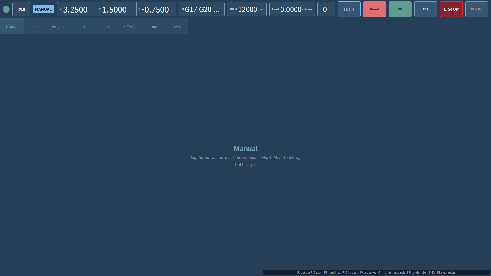

# Mill GUI plan

Status: skeleton built 2026-11-25 (shell, ribbon, placeholder tabs, mock and live backends, `dxfclean`); see [Running the GUI](#running-the-gui). The GUI is built ahead of the retrofit against the [sim config](../config/README.md), as the parallel track in the [retrofit plan](retrofit-plan.md).

## Decisions

| # | Topic | Decision (2026-11-25) |
|---|---|---|
| G1 | Relation to the lathe GUI | Separate codebase in this repo. Pieces are copied from the lathe GUI (jacob-cnc/Industry-CAM-Engine) and then diverge; no shared library. Every copied file is logged below with its lathe commit, so a lesson learned on one machine can be ported to the other by hand. |
| G2 | G-code source | No commercial CAM. Conversational ops are our own Python generators in the GUI, using QtPyVCP's `ops` as the starting point. External G-code runs through the Run tab; PureCutCNC is the first external CAM to trial, FreeCAD CAM the fallback. See the investigation below. |
| G3 | Probing | No probe yet. Design probing and tool-setter support following Probe Basic's approach so a probe can be added later. |
| G4 | Toolpath preview | Build both: a pixel-accurate 2D view with a plane selector (XY / XZ / YZ), like the lathe's coordinate map, and a 3D view. |
| G5 | Screen | Same 15.6 in panel as the lathe. |
| G6 | Conversational and DXF | Conversational programs built in the GUI from DXF geometry, ProtoTRAK style; externally generated G-code stays supported. DXF import is DXF-Tooling's `dxfclean` package, copied as is from DXF-Tooling main and patched here as needed (DXF-Tooling PR #17 is not in the copy). |
| G7 | Licensing | No plans to distribute. Copy open-source code (QtPyVCP, NGCGUI, Probe Basic) wherever that integrates most cleanly, keeping the original license headers and logging the source like the lathe carryover. |
| G8 | Cutter compensation | Use LinuxCNC cutter compensation (G41/G42) for profile cuts: the program follows the part contour, and the tool diameter comes from the tool table. |
| G9 | Pocket roughing | LinuxCNC computes the offsets: the pocket contour is repeated with G41.1 and a growing `D` value. No offset geometry in the GUI. |

## Lathe features, sorted

| Lathe part | Mill | Notes |
|---|---|---|
| Shell: status bar, colors, unit state, error dialog, numeric fields, offline-mode launcher | Copy | Status bar DRO becomes X/Y/Z |
| HAL backend (live and mock) | Copy and adapt | 3 joints; drop lathe quirks (swapped stepgens, radius X) |
| Edit tab | Copy | |
| Run tab | Copy and adapt | Preview replaced per G4 |
| Manual tab | Copy and adapt | Touch-off becomes X/Y/Z work offsets; compound slide dropped |
| Tools tab | Copy and adapt | Mill fields: diameter, length offset, type, flutes, stickout |
| Setup: HAL Monitor | Copy | |
| Setup: Commission | Copy and adapt | Mill checklist steps |
| Setup: Tuning | Replace | Velocity and acceleration testing for open-loop steppers, step timing, backlash |
| Help and G-code reference | Copy and adapt | Mill topics and codes |
| Program tab (lathe CAM), Debug tab | Drop | Turning-specific |

## New for the mill

1. Work offsets page (G54–G59.3).
2. Probing routines: edge, corner, bore/boss, Z surface (G3).
3. Tool change prompt and tool length measurement on a tool setter (G3).
4. Pre-run fit check: program extents in the active work offset against soft limits and stock; tools called but missing from the table.
5. Limit override flow for backing off a tripped shared home/limit switch.
6. Fault panel with plain-language messages: E-stop chain, VFD fault, drive alarm, limit trip.
7. Spindle commanded rpm and a warm-up routine.
8. WHB04B pendant status.
9. Flood coolant toggle.

## Preview approach (G4)

- **One path source for both views.** On the LinuxCNC PC, use LinuxCNC's own interpreter (the Python `gcode` module that AXIS's preview uses) to turn a program into moves. It already handles canned cycles, subroutines, cutter compensation and tool length offsets, so the preview matches what the machine will do. Offline on Windows that module isn't available, so a simpler parser is the fallback and the GUI says so.
- **2D view:** pyqtgraph, as on the lathe, with a plane selector.
- **3D view:** start with pyqtgraph's OpenGL module (same library, lightest addition) for toolpath lines, machine envelope, stock box and tool position. VTK (used by QtPyVCP-based GUIs such as Probe Basic) is the option if material-removal display is wanted later.

## Probing approach (G3), following Probe Basic

Probe Basic is GPLv2, built on QtPyVCP, and runs on LinuxCNC 2.9 / 2.10 on Debian 12 ([repo](https://github.com/kcjengr/probe_basic)). The part worth following is that its probing logic lives in G-code subroutines, not in the GUI:

- The GUI collects parameters and calls an O-word subroutine through MDI.
- The subroutine probes with G38.x and writes results to parameters or work offsets.
- Tool-setter measurement hangs off an M6 remap, so it runs the same from a program or from MDI.

Our GUI can call the same kind of subroutines without using QtPyVCP. If Probe Basic's subroutine files are copied in, they stay GPLv2 with their headers intact.

## G-code source investigation (G2), 2026-11-25

Requirements: conversational programming inside the GUI, built on DXF geometry the way ProtoTRAK's DXF option works; externally generated G-code still loads and runs.

| Candidate | What it is | Finding |
|---|---|---|
| [QtPyVCP `ops`](https://github.com/kcjengr/qtpyvcp/tree/main/src/qtpyvcp/ops) (behind Probe Basic's conversational screens) | About 270 lines of Python: facing (zig-zag with arc ramps) and hole ops (G81/G82/G83/G73, G84/G74 tapping, rigid tap, hole circle) emitting plain G-code | Small, readable, same language as the GUI. Covers only facing and holes. GPL. |
| NGCGUI ([library](https://github.com/LinuxCNC/linuxcnc/tree/master/nc_files/ngcgui_lib)) | Ships with LinuxCNC. Each op is a G-code subroutine (slot, hole circle, inside/outside quad and hex, quad pocket, helix ...); the GUI builds a form from the subroutine's parameter header and emits an `o<name> call` | Reliable (runs in LinuxCNC's own interpreter) but limited to fixed shapes: a subroutine can't take an arbitrary DXF profile. Ops are tedious to write in G-code. GPLv2. |
| [simple-gcode-generators](https://github.com/LinuxCNC/simple-gcode-generators) | Standalone Tkinter scripts (face, pocket, bolt circle, counterbore, engrave ...) | Python 2 (`from Tkinter import *`), last change April 2020. Useful only as algorithm reference. GPL-3.0. |
| dxf2gcode ([SourceForge](https://sourceforge.net/projects/dxf2gcode/files/)) | PyQt5 + PyOpenGL desktop app: DXF contours to G-code with cutter compensation and post-processors | Alive (new installer Nov 2026), but a whole app with its own DXF reader and extra tools (pstoedit, pdftops). Better as a reference than as code to embed. GPLv3. |
| [PureCutCNC](https://github.com/PureCutCNC/purecutcnc) | TypeScript browser/desktop 2.5D/3D CAD/CAM; DXF/SVG/STEP import; pockets, edge routes, drilling, V-carve; exports checked against LinuxCNC's parser | Most capable and very active, but young (created March 2026) and not embeddable in a Python GUI. Good external CAM. Apache-2.0. |
| FreeCAD CAM workbench | Full CAM inside FreeCAD, with a LinuxCNC post | Heavy dependency and steep learning curve; external use only. |

### Chosen approach (accepted 2026-11-25)

1. **Conversational engine: our own Python op generators in the GUI**, modeled on ProtoTRAK events (position/drill, bolt circle, line and arc mill with tool left/right/center, pocket, profile, face). QtPyVCP's `ops` is the pattern and the starting point for facing and holes. Output is plain LinuxCNC G-code (canned cycles for holes, G41/G42 for profile finishing), so a program runs, previews and edits like any other file.
2. **DXF importer: copied from DXF-Tooling's `dxfclean` package** (cleanup, spline-to-arc fitting, chaining, circle splitting, with its test suite). It already handles the CAD-export problems seen on the ProtoTRAK work (duplicate arcs, splines, broken chains). Copied as is from DXF-Tooling main; the closed-spline crash fix in DXF-Tooling PR #17 is not included and gets ported here if needed. Chained contours become profile/pocket events; circles become hole events.
3. **External G-code: unchanged Run tab path.** PureCutCNC is the first external CAM to trial; FreeCAD CAM is the fallback.
4. Not used: NGCGUI (can't take DXF geometry), simple-gcode-generators (Python 2), dxf2gcode as code (whole app).

### Cutter compensation rules (G8)

LinuxCNC's G41/G42 has requirements the generators must meet, and the GUI should check them before a program is written, with a plain-language message naming the feature and the fix:

- Comp turns on with a straight lead-in move longer than the tool radius, in G17, and turns off (G40) with a lead-out move clear of the part.
- An inside corner arc smaller than the tool radius, or a notch narrower than the tool, makes LinuxCNC stop with a gouge error. The pre-check catches this against the tool table diameter.

### Pocket roughing (G9)

A pocket's finish pass is a G41 profile of its contour. Roughing repeats the same contour with G41.1 and a growing `D` (tool diameter plus twice the accumulated step-over), so LinuxCNC computes each inward offset. Limits the generator must handle:

- An offset larger than an inside arc radius, or one that would split the pocket into separate regions, makes LinuxCNC stop. The generator stops growing `D` before that point, and the pre-check reports what is left uncut.
- The innermost pass leaves a centre area; a final clearing move covers it.

## Carryover log

Each copied file gets a row: source repo and path, source commit, mill path, and what changed. Sources include the lathe GUI, DXF-Tooling, and open-source projects (G7).

| Source file | Source commit | Mill file | Changes |
|---|---|---|---|
| Lathe `gui/colors.py`, `gui/unit_state.py`, `gui/components/elided_label.py`, `gui/components/numeric_field.py`, `gui/components/collapsible_section.py` | Industry-CAM-Engine dfb1c1a | same paths | None (byte-identical) |
| Lathe `gui/debug_overlay.py` | Industry-CAM-Engine dfb1c1a | `gui/debug_overlay.py` | Env vars `MILL_GUI_DEBUG_UI` / `MILL_GUI_SNAPSHOT_DIR`; snapshots go to `%LOCALAPPDATA%\MillGUI\ui_snapshots`; page-letter list in the docstring |
| Lathe `gui/components/status_bar.py` | Industry-CAM-Engine dfb1c1a | `gui/components/status_bar.py` | X/Y/Z DRO; RPM is commanded speed and its box fits 5 digits; OFFLINE badge set from the backend (`set_offline`) instead of "linuxcnc importable" |
| Lathe `gui/main_window.py` | Industry-CAM-Engine dfb1c1a | `gui/main_window.py` | Mill placeholder tabs; lathe tab wiring, green cycle button and `restore_lathe_modes` dropped; software E-stop commands E-stop (lathe: machine off); feed readout shows actual feed (lathe passes the feed override, see note) |
| Lathe `hal/interface.py` | Industry-CAM-Engine dfb1c1a | `machine/interface.py` | Package renamed `hal` → `machine` so it can't shadow LinuxCNC's `hal` module; X/Y/Z axes; no diameter; `current_feed`, `active_wcs`, `estop()`, `set_flood()` added |
| Lathe `hal/factory.py` | Industry-CAM-Engine dfb1c1a | `machine/factory.py` | Package rename only |
| Lathe `hal/mock_backend.py` | Industry-CAM-Engine dfb1c1a | `machine/mock_backend.py` | Per-axis lists; no compound/MPG simulation; flood, E-stop, spin-up delay; errors reported once |
| Lathe `hal/live_backend.py` | Industry-CAM-Engine dfb1c1a | `machine/live_backend.py` | Kept error draining, `program_busy`, mode rules, `program_open`. Dropped compound HAL component, MPG mux, diameter, spindle encoder. Added Y, joint/teleop jog switching before homing, flood, E-stop. Not yet run against LinuxCNC. |
| Lathe `hal/constants.py` | — | `machine/constants.py` | Rewritten for the mill from `config/mill-sim.ini` |
| DXF-Tooling `dxfclean/` (whole package) | DXF-Tooling c779a7f (main) | `dxfclean/` | None (copied as is; PR #17 not included) |
| DXF-Tooling `tests/test_*.py` except the 4 that test `app.py`, and `fixtures/*.dxf` | DXF-Tooling c779a7f | `tests/dxfclean/`, `tests/fixtures/` | None; layout keeps the tests' relative fixture paths working. 64 pass. |

**Possible lathe ports noticed while copying:**

- Lathe `main_window.py` passes `feed_override` to `status_bar.update_feed()`, which labels it in/min. The mill shows the actual feed rate (`stat.current_vel` × 60).
- Lathe status bar decides OFFLINE from "is `linuxcnc` importable", so on the lathe PC with LinuxCNC not running it shows mock data without the badge. The mill asks the backend.

## Running the GUI

Requirements: Python 3 with PyQt5, pyqtgraph, ezdxf and matplotlib (`requirements.txt`).

- **Offline (any PC):** `python -m gui.main_window` from the repo root. Uses the mock backend and shows the OFFLINE badge.
- **Against the sim (LinuxCNC PC):** start the sim (`linuxcnc config/mill-sim.ini`, AXIS opens), then run `python3 -m gui.main_window` in a second terminal. The GUI attaches to the running LinuxCNC as a second display. Making it the config's `DISPLAY` comes later.
- **Debug overlay:** set `MILL_GUI_DEBUG_UI=1`. Snapshots (F9) go to `%LOCALAPPDATA%\MillGUI\ui_snapshots`.
- **Tests:** `python -m pytest tests`.

